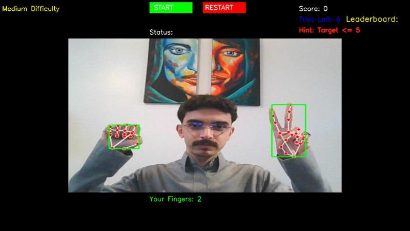

# Warm & Cold Game

A hands-free number-guessing game you play with your fingers in front of a webcam.
The game hides a target number (1-10); you guess by holding up that many fingers,
and it answers with **Warm** or **Cold** hints until you find it.



## How it works

- **Hand tracking:** [MediaPipe](https://developers.google.com/mediapipe) detects
  your hands and counts how many fingers are raised (works with up to two hands).
- **Adaptive targets (Markov / MDP):** the next target isn't just `random`. It's
  sampled from a probability distribution shaped by your current guess and the
  chosen difficulty:
  - **Easy:** `P(next) ∝ 1 / (1 + distance)` - the next number tends to stay near your last guess.
  - **Medium:** `P(next) ∝ 1 / (1 + distance²)` - a tighter distribution.
  - **Hard:** uniform - any number is equally likely.
- **Warm / Cold feedback:** a guess within 2 of the target is "Warm", otherwise "Cold".
- **Dynamic difficulty:** correct guesses earn extra tries (the amount scales with difficulty).
- **Leaderboard:** enter your name after a winning streak to record your score.
- **Audio feedback:** success and game-over sound cues.

## Requirements

- Python 3.9+
- A webcam

Install the dependencies:

```bash
pip install -r requirements.txt
```

## Run

```bash
python main.py
```

## Controls

- **START** / **RESTART** buttons (click them in the window).
- Hold up **1, 2, or 3** fingers and keep steady to choose **Easy / Medium / Hard**.
- Hold a finger count **steady for a moment** to lock in a guess.
- Press **Q** to quit.

## Notes

- The webcam is selected by `CAMERA_INDEX` at the top of `main.py` (default `0`).
  If the wrong camera opens, change it to `1`.
- Built with Python, OpenCV, MediaPipe, and NumPy.
